<div align="center">


# 个人 AI 日志 · Personal Daily Log

**把散落一天的真实活动证据，凝练成可追溯的三时段日记**

[](https://github.com/RoxyXu151/daily-log/actions/workflows/test.yml)
[](https://roxyxu151.github.io/daily-log/)
[](go.mod)
[](LICENSE)

[**🌐 在线交互展示页**](https://roxyxu151.github.io/daily-log/) · [**🎬 动态演示**](#-交互动效与数据流转演示) · [**🖼️ 三端界面画廊**](#-原生桌面工作台全景预览) · [**🚀 30 秒快速体验**](#-快速开始与终端演示) · [**📐 架构与文档**](#-系统架构与文档索引)

</div>

---

<picture>
  <source media="(prefers-color-scheme: dark)" srcset="site/assets/dark-dashboard-wide.png">
  <source media="(prefers-color-scheme: light)" srcset="site/assets/light-dashboard-wide.png">
  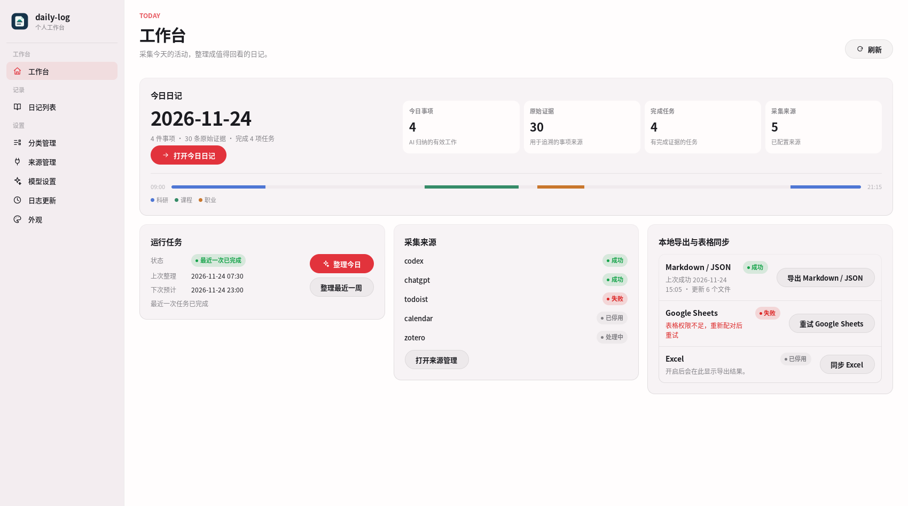
</picture>

`daily-log` 是一款**纯 Go 单可执行文件、本地优先**的个人活动采集与 AI 日志工作台（当前版本 `0.3.0`）。它自动汇集 Zotero 文献标注、Todoist 完成任务、Codex 编码讨论、Google Calendar 日程、GitHub / GitLab 提交、WakaTime 编码时长、ActivityWatch 窗口记录以及 Obsidian / Logseq 本地笔记，将同一天的跨工具碎片归并为**上午、下午、晚上**三个时段的高价值事项。

- **证据锚定，拒绝臆造**：每条事项包含 ≤28 字短标题与具体进展说明，直连原始采集证据；无可靠起止记录时保持用时未知，绝不凭空推算分钟数。
- **人工内容零覆盖**：手动编辑保存的日记永不被后续重跑覆盖；Google Sheets 与本地 Excel 原生增量更新，完整保留手改单元格、公式与既有样式。
- **全链路凭证隔离与脱敏**：所有外部连接默认关闭；密钥隔离存储于 `0600` 权限的 `.env` 或 `*.settings.json`，提取与同步前自动遮盖已知密钥和私钥块。
- **水位回查与三端协同**：按各来源最后成功水位重叠补采，关机多日后开机自动自愈；CLI、MyGo 原生桌面端（Linux / Windows）与 Android HTTPS 浏览器配对共享同一套 SQLite 数据与并发版本对照。

---

## 🎬 交互动效与数据流转演示

### 1. 原生桌面工作台动态巡览

> 依次展示：**今日工作台与 `dayRibbon` 时间带** → **日记总表平滑展开三时段事项** → **宽屏正文与证据并排编辑** → **标准来源目录接入** → **多模型参数配置** → **海蓝色温与深色外观切换**。

<p align="center">
  
</p>

### 2. 实例对照：散落的原始碎片 → 可追溯的三时段日记

假设你在一天内产生了以下跨工具活动记录，`daily-log run` 将自动完成**去重、脱敏、会话推断与受约束归纳**：

<table>
<tr>
<th width="48%">📥 输入：多来源原始活动批次（本地 SQLite <code>events</code>）</th>
<th width="52%">📤 输出：三时段 Markdown 日记（<code>2026-11-24.md</code>）</th>
</tr>
<tr>
<td>

- **`09:12` Codex（3 轮对话）**  
  围绕论文第三章定理 2 的反例构造与数据集引用口径修订两段推导（过滤闲聊与工具原始输出，保留轮次引用 `codex://threads/1`）
- **`09:48` Zotero（4 条新建 PDF 标注）**  
  同一篇论文 30 分钟内的高亮与笔记自动聚合为 1 次阅读会话
- **`13:42` Codex + `15:04` GitHub Push**  
  排查 150 虚拟节点负载标准差，推送 3 次提交通过扩容迁移测试
- **`15:58` Todoist 已完成任务 + `16:14` Obsidian 编辑**  
  勾选完成「改写个人项目量化指标」并更新本地简历笔记
- **`20:00` Google Calendar 日程**  
  周期日程实例「课题组周报与实验排期」（仅作日程证据，不冒充完成任务数或活跃时长）

</td>
<td>

```markdown
# 2026-11-24 日志

## 上午

整理论文第三章论证结构 · 定下反例与数据来源的对应关系，
改写两段核心推导，并关联同日文献标注证据。

## 下午

一致性哈希分片模拟 · 实现虚拟节点环并跑通扩容与缩容时
的键迁移回归测试。
简历项目描述量化改写 · 将三段工程经历替换为可核验的吞吐
与测试覆盖指标。

## 晚上

组会周报与下周实验排期 · 汇总本周消融实验结果表格，明确
下周三组对比基线参数。
```

</td>
</tr>
</table>

<details>
<summary><b>🔍 点击展开对应的结构化 JSON 导出与 Google Sheets / Excel「活动占比」同步单元格实例</b></summary>

<br>

**结构化 JSON 导出（`outputs/markdown/2026-11-24.json`）**——保留输入指纹 `input_hash`、关联证据 ID 列表以及未手填前严格为 `null` 的分类分钟数：

```json
{
  "date": "2026-11-24",
  "status": "已生成",
  "ai_work_items_only": true,
  "上午": "整理论文第三章论证结构 · 定下反例与数据来源的对应关系，改写两段核心推导，并关联同日文献标注证据。",
  "下午": "一致性哈希分片模拟 · 实现虚拟节点环并跑通扩容与缩容时的键迁移回归测试。\n简历项目描述量化改写 · 将三段工程经历替换为可核验的吞吐与测试覆盖指标。",
  "晚上": "组会周报与下周实验排期 · 汇总本周消融实验结果表格，明确下周三组对比基线参数。",
  "manual": "",
  "minutes": {
    "科研学习与论文": null,
    "课程学习": null,
    "职业学习与求职": null,
    "校园事务与个人生活": null
  },
  "evidence": [
    { "event_id": "e1", "source": "codex", "type": "conversation_activity", "url": "https://example.test/threads/1" },
    { "event_id": "e2", "source": "zotero", "type": "annotation_created", "url": "zotero://select/library/items/8K2A" },
    { "event_id": "e3", "source": "todoist", "type": "task_completed", "url": "" }
  ],
  "input_hash": "8f4b2e9c1d7a6035ab12c94ef0182d77c63a5190e44b82c1f309a7d5e21c4b08"
}
```

**Google Sheets / 本地 Excel「每日活动」表 F 列自动渲染效果**（12 格等比进度条 + 最大余数法精确合计 100%；右侧手填实际投入分钟后下次同步自动追加用时占比）：

```text
数量占比（含课程记录） · 6项
科研 ██████░░░░░░ 50% · 3项
课程 ████░░░░░░░░ 33.3% · 2项
职业 ██░░░░░░░░░░ 16.7% · 1项
生活 ░░░░░░░░░░░░ 0% · 0项
用时占比 · 298分钟 · 已填3/4类
科研 ███████░░░░░ 61.1% · 182分钟
课程 ████░░░░░░░░ 32.2% · 96分钟
职业 未记录
生活 █░░░░░░░░░░░ 6.7% · 20分钟
```

</details>

---

## 🖼️ 原生桌面工作台全景预览

> 以下全部截图均由 `desktop/visual_test.go` 原生无头渲染直出，**会根据你当前的 GitHub 浅色／深色外观自动切换对应主题截图**。

<table>
<tr>
<td width="50%" valign="top">

**01 · 今日工作台与 `dayRibbon` 全天时间轴**  
按真实起止证据比例绘制分类色带，空档即留白；一屏掌握事项、证据、来源健康与同步结果。

<picture>
  <source media="(prefers-color-scheme: dark)" srcset="site/assets/dark-dashboard.png">
  <source media="(prefers-color-scheme: light)" srcset="site/assets/light-dashboard.png">
  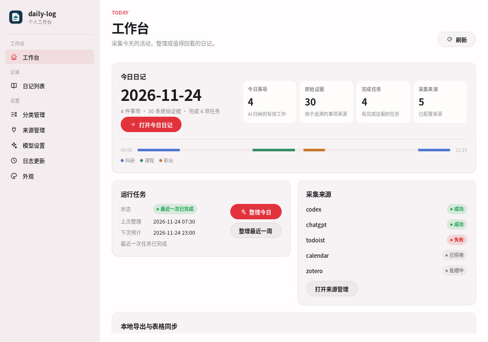
</picture>

</td>
<td width="50%" valign="top">

**02 · 日记总表与三时段事项展开**  
按日概览分类精华与完成数；点击任意日期行原地平滑展开上午／下午／晚上高价值事项。

<picture>
  <source media="(prefers-color-scheme: dark)" srcset="site/assets/dark-journal-expanded.png">
  <source media="(prefers-color-scheme: light)" srcset="site/assets/light-journal-expanded.png">
  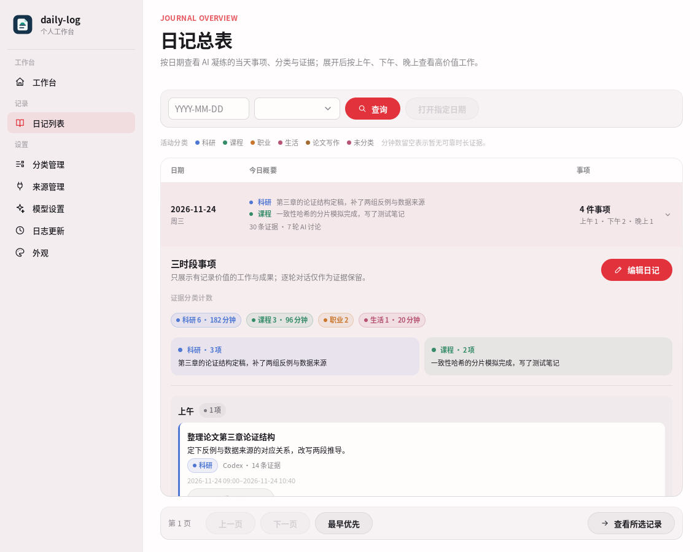
</picture>

</td>
</tr>
<tr>
<td width="50%" valign="top">

**03 · 宽屏正文与原始证据并排编辑**  
左侧分时段修订正文与本人补充，右侧同屏查阅关联证据、手工修正活动分类或比对历史版本。

<picture>
  <source media="(prefers-color-scheme: dark)" srcset="site/assets/dark-editor.png">
  <source media="(prefers-color-scheme: light)" srcset="site/assets/light-editor.png">
  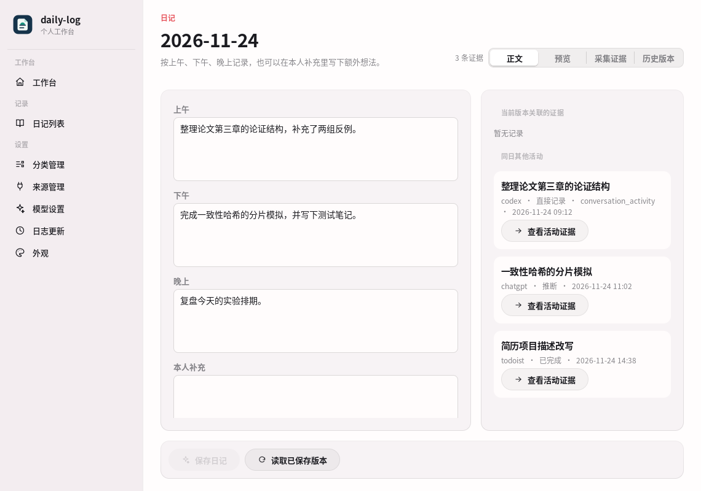
</picture>

</td>
<td width="50%" valign="top">

**04 · 来源管理与标准服务目录**  
内置常见研发、科研与本地笔记目录，填入凭证即可一键测试连通性、查看采集覆盖窗口或独立开关。

<picture>
  <source media="(prefers-color-scheme: dark)" srcset="site/assets/dark-sources-catalog.png">
  <source media="(prefers-color-scheme: light)" srcset="site/assets/light-sources-catalog.png">
  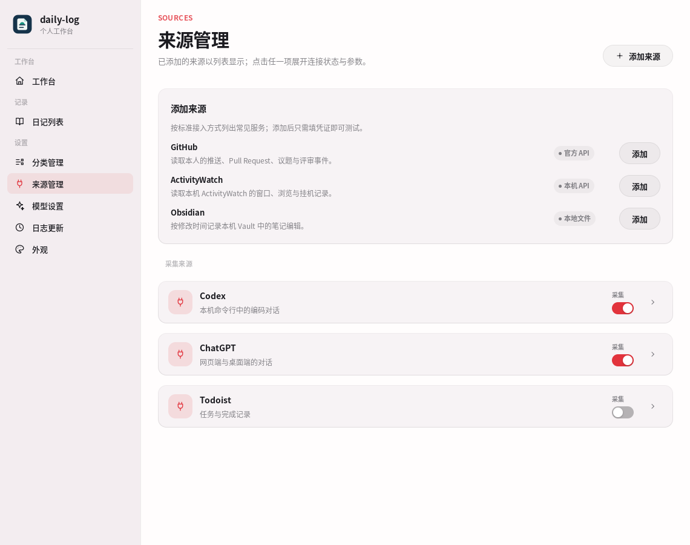
</picture>

</td>
</tr>
<tr>
<td width="50%" valign="top">

**05 · 多模型卡片管理（本地 + 云端）**  
支持本地无密钥服务（Ollama / vLLM）与云端 OpenAI 兼容接口，一键拉取官方模型列表并切换全局默认。

<picture>
  <source media="(prefers-color-scheme: dark)" srcset="site/assets/dark-models-form.png">
  <source media="(prefers-color-scheme: light)" srcset="site/assets/light-models-form.png">
  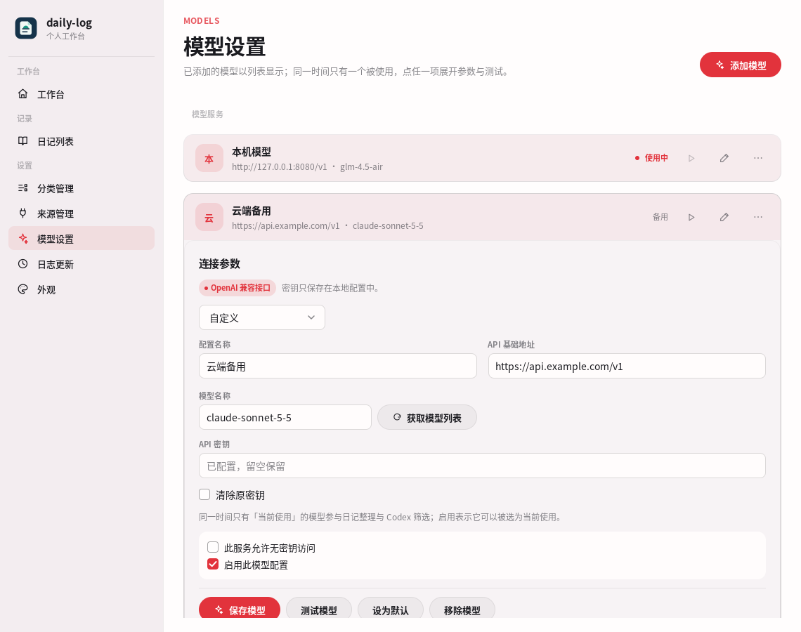
</picture>

</td>
<td width="50%" valign="top">

**06 · 动态分类与简称迁移**  
分类不再是硬编码枚举：支持自定义分类与两字简称，重命名自动迁移历史事件与手工覆盖，删除安全归入「未分类」。

<picture>
  <source media="(prefers-color-scheme: dark)" srcset="site/assets/dark-categories.png">
  <source media="(prefers-color-scheme: light)" srcset="site/assets/light-categories.png">
  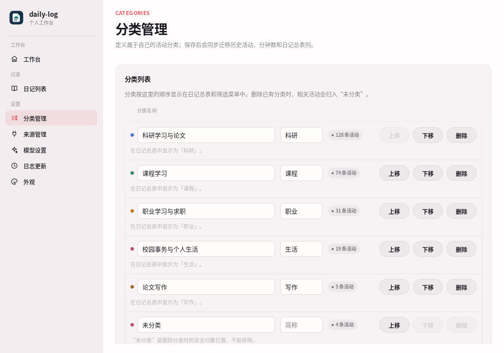
</picture>

</td>
</tr>
<tr>
<td width="50%" valign="top">

**07 · 定时整理与纳入事件类型配置**  
自定义每日归档时刻（默认北京时间 `23:00`）、回查天数与纳入事件类型，界面内明确确认安装系统定时任务。

<picture>
  <source media="(prefers-color-scheme: dark)" srcset="site/assets/dark-schedule.png">
  <source media="(prefers-color-scheme: light)" srcset="site/assets/light-schedule.png">
  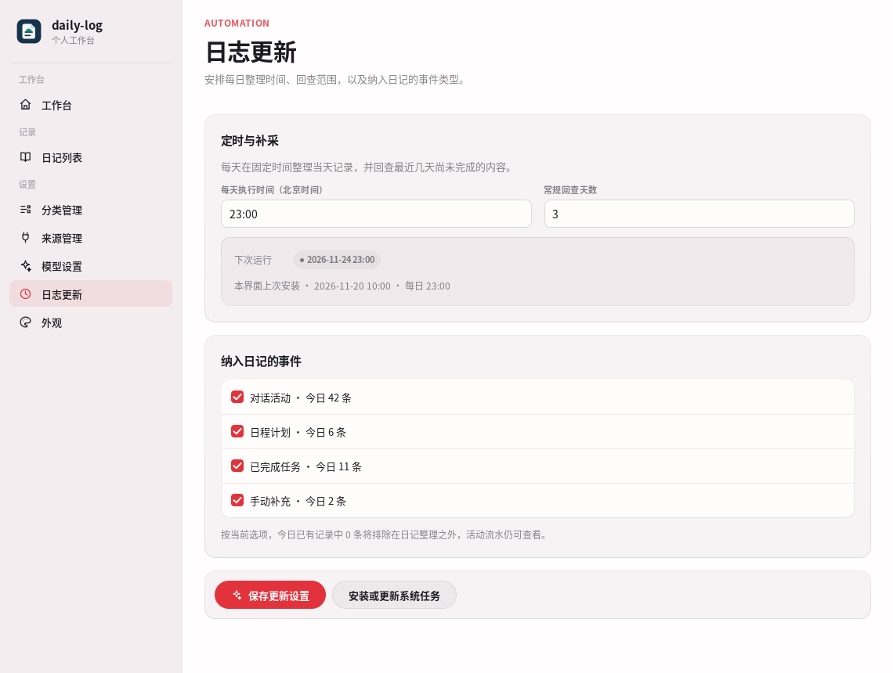
</picture>

</td>
<td width="50%" valign="top">

**08 · Oklab 房间色温与非位移悬浮提示**  
切换「海蓝 / 青绿 / 紫罗兰」会整体改变五级面的冷暖色温；右下角错误与进度牌悬浮呈现，绝不推动正文跳动。

<picture>
  <source media="(prefers-color-scheme: dark)" srcset="site/assets/dark-notice.png">
  <source media="(prefers-color-scheme: light)" srcset="site/assets/light-notice.png">
  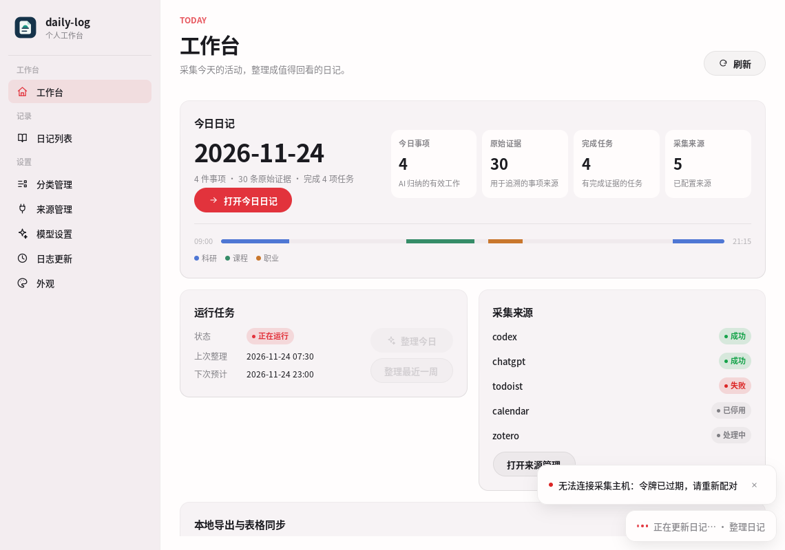
</picture>

</td>
</tr>
</table>

---

## 📱 Android 浏览器安全配对与多端协同

无需把私人数据库托管到第三方云服务。桌面端将同一套 MyGo 界面编译为 WebAssembly，手机在局域网通过受信任 HTTPS 证书直连采集主机：

- **安全配对机制**：默认仅监听 `127.0.0.1`；跨设备访问须显式指定可达地址与 TLS 证书，通过 **10 分钟一次性配对码**换取 **12 小时受限加密会话**。
- **移动输入与弱网保护**：适配窄屏单列布局与中文软键盘长文滚动；断网保留未保存草稿支持原页重试，多端同时保存同一天日记时自动弹出**版本冲突对照**。

<table>
<tr>
<td width="33.3%" align="center" valign="top">

**移动工作台（420px 窄屏适配）**

<picture>
  <source media="(prefers-color-scheme: dark)" srcset="site/assets/dark-dashboard-phone.png">
  <source media="(prefers-color-scheme: light)" srcset="site/assets/light-dashboard-phone.png">
  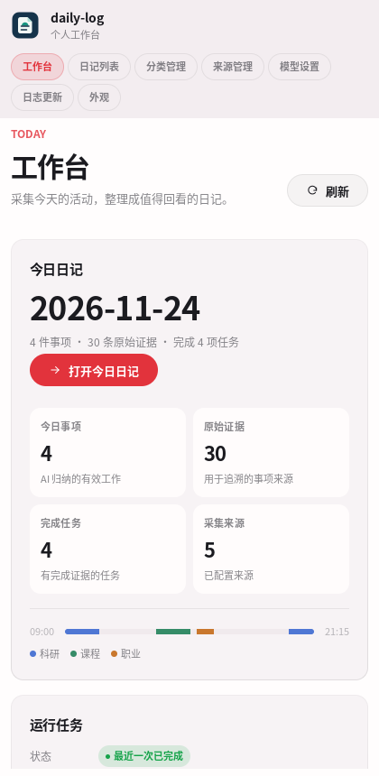
</picture>

</td>
<td width="33.3%" align="center" valign="top">

**移动日记列表（触控筛选与展开）**

<picture>
  <source media="(prefers-color-scheme: dark)" srcset="site/assets/dark-phone-journal.png">
  <source media="(prefers-color-scheme: light)" srcset="site/assets/light-phone-journal.png">
  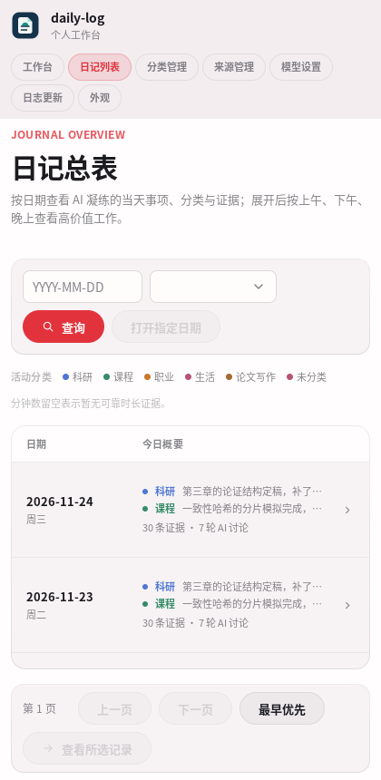
</picture>

</td>
<td width="33.3%" align="center" valign="top">

**移动正文编辑（防丢稿与版本保护）**

<picture>
  <source media="(prefers-color-scheme: dark)" srcset="site/assets/dark-phone-editor.png">
  <source media="(prefers-color-scheme: light)" srcset="site/assets/light-phone-editor.png">
  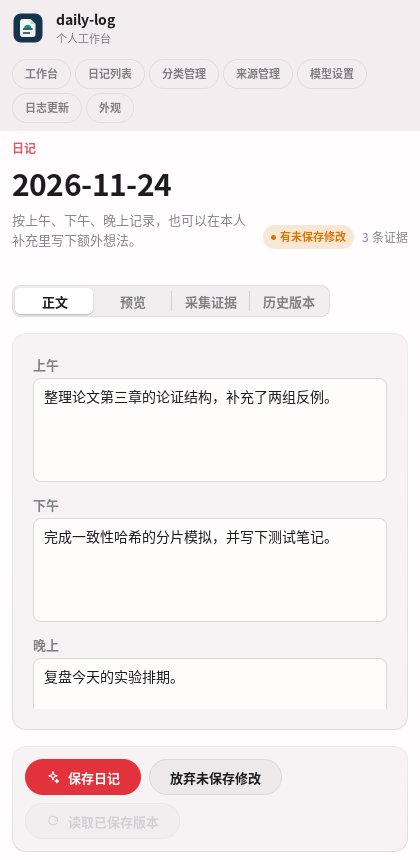
</picture>

</td>
</tr>
</table>

---

## 🧭 系统架构与连接生态

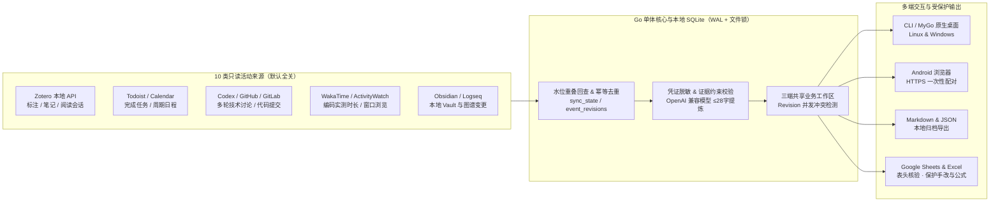

### 内置与目录连接器一览

| 领域 | 名称 | 接入协议 | 采集语义与隐私边界 |
| --- | --- | --- | --- |
| **文献与日程** | **Zotero** | 本机 HTTP API (`23119`) | 只读扫描标注、笔记与论文元数据，无需云端密钥，自动推断阅读会话 |
| **文献与日程** | **Todoist** | 官方 REST API | 采集本人完成事件并补充描述快照，自动提示免费版 7 天历史窗口缺口 |
| **文献与日程** | **Google Calendar** | OAuth PKCE / 服务账号 | 只读日历，展开重复日程实例并同步取消状态，与同名待办智能去重 |
| **AI 与研发** | **Codex** | 本机 / SSH `app-server` | 按完整轮次只读提取用户与助手最终回复，过滤思考链与密钥，支持多远程主机 |
| **AI 与研发** | **GitHub** | 官方 REST API | 采集 Push、Pull Request、Issue 与代码评审记录（`GITHUB_TOKEN`） |
| **AI 与研发** | **GitLab** | REST API v4 | 支持 `gitlab.com` 与自建实例的推送、Merge Request 与议题事件 |
| **AI 与研发** | **WakaTime** | 官方 REST API | 拉取每日按项目汇总的实测编码分钟数（忽略 <1 分钟碎片） |
| **本机与笔记** | **ActivityWatch** | 本机 HTTP API (`5600`) | 读取本机窗口与浏览器存储桶，自动跳过 AFK 挂机桶与瞬时切换 |
| **本机与笔记** | **Obsidian / Logseq** | 本地文件夹扫描 | 按修改时间记录 `.md` / `.org` 笔记编辑，自动排除日志自身导出目录 |
| **导出与同步** | **Markdown / JSON** | 本地文件系统 | 默认启用，输出人类可读三时段日志与带证据指纹的 JSON |
| **导出与同步** | **Google Sheets / Excel** | REST API / 纯 Go Excelize | 同步四张工作表，写前复读 + 写后核验，保留人工内容、公式与五份自动备份 |

---

## 🚀 快速开始与终端演示

### 1. 零配置体验合成演示（无需任何账号或 API Key）

使用 Go `1.24+` 构建单可执行文件并运行 `demo`，合成数据输出在独立的 `daily-log-demo/` 目录，重复执行完全幂等：

```sh
go build -trimpath -o dist/daily-log ./cmd/daily-log   # Windows 改为 dist/daily-log.exe
./dist/daily-log --version
./dist/daily-log demo
```

终端输出示例：

```json
{
  "date": "2026-11-27",
  "mode": "synthetic-demo",
  "outputs": {
    "markdown": {
      "directory": "daily-log-demo/journals",
      "written_files": 2
    }
  }
}
```

### 2. 初始化真实工作区与常用 CLI 命令

```sh
daily-log init                         # 在当前目录生成默认离线配置 config.yaml
daily-log doctor                       # 检查本地配置、数据库锁与已启用来源的连通性
daily-log run                          # 依次执行：采集 → AI 整理三时段事项 → 导出与表格同步
daily-log status                       # 查看各来源采集水位、事件计数与最近任务状态
daily-log show 2026-11-24              # 在终端查阅指定北京时间日期的日记 JSON
daily-log recover                      # 按已保存水位补采、补生成并重新同步
daily-log generate --date 2026-11-24   # 用当前默认模型重整指定日期（--all 重整全部缓存日期）
daily-log --config config.yaml backup  # 升级前安全备份 SQLite WAL 数据库至 daily-log-backups/
```

<details>
<summary><b>⚙️ 点击展开 <code>config.yaml</code> 与 <code>.env</code> 典型配置示例（DeepSeek / Ollama / 多主机 Codex / Excel）</b></summary>

<br>

配置文件同目录创建 `.env`（由 `.gitignore` 自动忽略，切勿写入 YAML）：

```dotenv
TODOIST_API_TOKEN=your_todoist_token
AI_API_KEY=your_openai_compatible_key
GITHUB_TOKEN=ghp_optional_token
GOOGLE_OAUTH_TOKEN=secrets/google-token.json
```

`config.yaml` 示例（所有相对路径均相对于配置文件所在目录解析）：

```yaml
timezone: Asia/Shanghai
database: data/daily-log.sqlite3
log_file: logs/daily-log.log
lookback_days: 3

zotero:
  enabled: true
  base_url: http://localhost:23119/api
  library: users/0
  session_gap_minutes: 30

todoist:
  enabled: true

codex:
  enabled: true
  required: false
  use_ai: true
  hosts:
    - name: local
      command: [codex, app-server, --listen, 'stdio://']
    - name: gpu-node
      command: [ssh, gpu-node, codex, app-server, --listen, 'stdio://']

markdown:
  enabled: true
  directory: outputs/markdown

excel:
  enabled: true
  path: outputs/local/个人活动日志.xlsx

ai:
  enabled: true
  base_url: https://api.deepseek.com   # 或本机 Ollama: http://127.0.0.1:11434/v1
  model: deepseek-chat
```

</details>

### 3. 启动原生桌面工作台与 Android 移动访问

桌面端构建需要 Go `1.27.3`（Linux 运行窗口需系统安装 GTK3）；首次启动自动在用户配置目录初始化工作区：

```sh
# 构建并启动原生桌面端（Windows 输出为 daily-log-gui.exe）
go -C desktop build -o ../dist/daily-log-gui .
./dist/daily-log-gui --config config.yaml

# 构建 WebAssembly 移动资源并启动局域网 HTTPS 手机配对
(cd desktop && mygo build -platform web)
./dist/daily-log --config config.yaml mobile --listen 192.168.1.20:8443 \
  --tls-cert /path/to/host.crt --tls-key /path/to/host.key
```

### 4. 安装每日 23:00 无人值守系统定时任务

无需常驻后台进程，关机错过的夜间任务会在下次开机登录时按水位自动补齐：

```sh
# Linux (systemd --user 持久化定时器)
bash scheduler/linux/install.sh
systemctl --user list-timers 'daily-log-*'

# Windows (PowerShell 注册 Task Scheduler 当前用户任务，不保存系统密码)
powershell -ExecutionPolicy Bypass -File scheduler/windows/install.ps1
```

---

## 📚 系统架构与文档索引

| 主题 | 文档链接 |
| --- | --- |
| **配置、授权与来源接入** | [配置与授权](docs/configuration.md) · [Google 首次授权 (PKCE)](docs/google-setup.md) · [Codex 会话采集规则](docs/codex-activity.md) |
| **数据语义与日记提炼规则** | [架构和数据语义](docs/architecture.md) · [日记事项规则](docs/journal-rules.md) · [每日活动占比口径](docs/activity-mix.md) |
| **表格增量同步与保护** | [Google Sheets 与 Excel 输出](docs/google-sheets-sync.md) · [本地 Excel 工作流](docs/local-excel.md) · [工作表字段定义](docs/sheets-schema.json) |
| **视觉与动效设计体系** | [界面设计系统 (`docs/design.md`)](docs/design.md) · [图形化版产品需求](docs/gui-requirements.md) |
| **部署、运维与公开发布** | [定时部署](docs/deployment.md) · [日常维护](docs/maintenance.md) · [验证方式](docs/acceptance.md) · [公开发布白名单构建](docs/public-release.md) |

## 🛠️ 开发验证与参与贡献

```sh
go vet ./... && go test ./...
go -C desktop vet ./... && go -C desktop test ./...
go run ./cmd/build-release
```

欢迎提交 Issue 或 Pull Request，参与开发前请阅读 [贡献指南](CONTRIBUTING.md) 与 [安全策略](SECURITY.md)。

## 📄 开源协议

本项目基于 [Apache License 2.0](LICENSE) 开源分发，归属声明见 [NOTICE](NOTICE)。
